# Kịch Bản Quay Video Demo Hệ Thống PodsCare Repair OS (FIXO)

Tài liệu này cung cấp kịch bản bấm máy chi tiết từng cảnh (**Thao tác màn hình** + **Dữ liệu nhập sẵn** + **Lời thuyết minh gợi ý**) dựa trên 100% dữ liệu thực tế từ source code và Database Seeder của dự án.

---

## 1. Bảng "Phao Cứu Trợ" (Cheat Sheet) Để Mở Sẵn Khi Quay

> [!TIP]
> **Mẹo quay mượt không bị ngắt quãng**: Thay vì tạo 1 đơn mới rồi phải tự đẩy qua 6 bước mất thời gian, Database Seeder (`apps/api/database/seeders/CustomerAndOrderSeeder.php`) đã chuẩn bị sẵn **7 đơn hàng ở 7 trạng thái khác nhau**. Bạn có thể dùng ngay từng mã đơn tương ứng ở mỗi cảnh!

### 1.1. Danh sách Tài khoản Đăng nhập (`/login`)
- **Mã gian hàng (Store Code)**: `fixo-master` *(mặc định đã điền sẵn)*
- **Mật khẩu chung cho mọi tài khoản**: `password`

| Vai trò | Nhân vật | Email đăng nhập | SĐT đăng nhập | Chi nhánh | Route mặc định |
| :--- | :--- | :--- | :--- | :---: | :--- |
| **1. Lễ tân / CSKH** | Lan Phạm | `cskh.lan@fixo.com.vn` | `0902 000 002` | `Q1` | `/dashboard` |
| **2. Kỹ thuật viên** | Tuấn K. | `ktv.tuan@fixo.com.vn` | `0903 000 003` | `Q1` | `/tech` |
| **3. Kiểm định QC** | Hải N. | `qc.inspector@fixo.com.vn` | `0904 000 005` | `Q1` | `/qc` |
| **4. Thủ kho** | Việt Trần | `kho.viet@fixo.com.vn` | `0905 000 006` | `Q1` | `/inventory` |
| **5. Chủ cửa hàng (Admin)** | Minh Lê | `admin@fixo.com.vn` | `0901 000 001` | `Q1` / `ALL` | `/dashboard` |
| **6. Chủ sàn SaaS (Super Admin)** | FIXO Platform | `superadmin@fixo.com.vn` | `0900000000` | Toàn sàn | `/platform` |

### 1.2. Danh sách 7 Mã Đơn Hàng Mẫu Có Sẵn Để Bấm Demo Ngay

| Mã đơn | Trạng thái hiện tại | Khách hàng & SĐT | Thiết bị | Dùng cho Cảnh quay nào? |
| :--- | :--- | :--- | :--- | :--- |
| **`FX26-00982`** | `waiting_approval` *(Chờ khách duyệt)* | **Lê Hoàng Long** · `0988112233` | AirPods 3 | **Cảnh 2**: CSKH xác nhận khách đồng ý báo giá (`350.000đ`) -> đẩy sang chờ kỹ thuật |
| **`FX26-00983`** | `waiting_tech` *(Chờ kỹ thuật)* | **Phạm Thu Hà** · `0977223344` | AirPods Pro | **Cảnh 3**: KTV Tuấn K. bấm **"Nhận đơn"** từ hàng đợi & in tem khay nhiệt K80 |
| **`FX26-00981`** | `in_repair` *(Đang sửa)* | **Nguyễn Minh Anh** · `0900000001` | AirPods Pro 2 | **Cảnh 1 & 3**: Khách tra cứu tại `/track`; KTV kê khai linh kiện & bấm **"Hoàn thành sửa"** |
| **`FX26-00984`** | `waiting_qc` *(Chờ QC)* | **Hoàng Nhật Nam** · `0918223344` | AirPods Pro 2 | **Cảnh 4**: QC Hải N. chấm 9 tiêu chí Checklist -> duyệt **QC ĐẠT** hoặc **Yêu cầu sửa lại** |
| **`FX26-00985`** | `ready_for_return` *(Sẵn sàng trả)* | **Đỗ Bích Phương** · `0933556677` | AirPods Max | **Cảnh 5**: CSKH thu tiền `1.200.000đ` qua **VietQR SePay / Tiền mặt**, trả máy & kích hoạt BH |
| **`FX26-00986`** | `completed` *(Hoàn tất)* | **Vũ Anh Tuấn** · `0912998877` | AirPods 2 | **Cảnh 6**: Tra cứu Bảo hành `FX26-WR-00986`, xem Bệnh án thiết bị, demo Bảo hành / Hoàn tiền |
| **`FX26-00987`** | `in_repair` *(Đang sửa - CN Q3)* | **Trần Bảo Ngọc** · `0909887766` | AirPods Pro 2 | **Cảnh 7**: Demo cô lập dữ liệu đa chi nhánh (`Q1` vs `Q3` vs `ALL`) của Admin |

---

## 2. Cách Bố Trí Cửa Sổ Trình Duyệt Trước Khi Quay

Để tránh phải đăng xuất/đăng nhập lại nhiều lần làm gián đoạn video, hãy mở sẵn **3 cửa sổ Chrome (hoặc 3 Profile / Ẩn danh)** tại địa chỉ `http://localhost:3000`:

```mermaid
flowchart LR
    W1["Cửa sổ 1 (Chính)\nPublic + CSKH + Store Admin"] --> S1["Cảnh 1: Landing & Tra cứu /track"]
    S1 --> S2["Cảnh 2: CSKH Mở ca & Tiếp nhận"]
    S2 --> W2["Cửa sổ 2 (Vận hành)\nKỹ thuật viên (/tech) + QC (/qc)"]
    W2 --> S3["Cảnh 3 & 4: Sửa chữa & Kiểm định QC"]
    S3 --> W1_Return["Quay lại Cửa sổ 1\nCảnh 5 & 6: VietQR, Trả máy, Bảo hành"]
    W1_Return --> S7["Cảnh 7: Admin Dashboard, Kho & Audit Diff"]
    S7 --> W3["Cửa sổ 3 (SaaS)\nCảnh 8: Super Admin /platform"]
```

---

## 3. Kịch Bản Quay Chi Tiết 8 Cảnh (Scene-by-Scene)

---

### CẢNH 1: Giới Thiệu Nền Tảng B2B SaaS & Cổng Tra Cứu Khách Hàng (01:30)
- **Màn hình**:
  1. Trang chủ SaaS: `http://localhost:3000/` (`apps/web/app/LandingPreview.tsx`)
  2. Đăng ký gian hàng: `http://localhost:3000/register` (`apps/web/app/register/page.tsx`)
  3. Cổng tra cứu tiến độ: `http://localhost:3000/track` (`apps/web/app/components/TrackingView.tsx`)

| Bước | Thao tác trên màn hình (Action) | Lời bình thuyết minh gợi ý (Voiceover) |
| :-: | :--- | :--- |
| **1.1** | Mở trang chủ `/`, cuộn mượt qua khu vực Hero, quy trình 4 bước và bảng giá SaaS. Chỉ chuột vào tông màu xanh ngọc trầm & nền ngà ấm. | *"Xin chào, đây là **PodsCare Repair OS (FIXO)** — nền tảng B2B SaaS quản trị vận hành chuỗi cửa hàng sửa chữa thiết bị công nghệ cao. Giao diện được thiết kế theo hệ thống Design System **Calm Jade & Warm Ivory** chuẩn phòng Lab Apple: phẳng 100%, không dùng gradient màu mè, giúp nhân viên làm việc liên tục cả ngày không mỏi mắt."* |
| **1.2** | Bấm nút **"Dùng thử miễn phí"** sang `/register`. Nhập thử tên cửa hàng `iCare Lab Sài Gòn` để hệ thống tự sinh mã gian hàng `icare-lab-sai-gon`. | *"Ở góc độ SaaS Multi-Tenant, bất kỳ chủ cửa hàng nào cũng có thể tự đăng ký gian hàng riêng và được kích hoạt ngay gói dùng thử 3 tháng."* |
| **1.3** | Chuyển sang trang `/track`. - **Lần 1**: Chỉ nhập mã đơn `FX26-00981` (không nhập SĐT) -> Bấm **Tra cứu**. Chỉ vào tên khách `Ng***h` và SĐT `090***01` đang bị che mờ. - **Lần 2**: Nhập thêm SĐT chính chủ `0900000001` -> Bấm **Tra cứu lại**. Cuộn xem Thanh tiến trình 5 bước, bộ phận bàn giao (`Tai trái L`, `Tai phải R`, `Hộp sạc`) và bảng 9 hạng mục Checklist tiếp nhận. | *"Với khách hàng cuối, họ có thể quét QR trên phiếu biên nhận để tra cứu tiến độ sửa chữa thời gian thực mà không cần đăng nhập. Hệ thống tích hợp cơ chế bảo mật **PII Masking** — tự động che mờ danh tính nếu chỉ có mã đơn, và chỉ hiển thị đầy đủ kèm 9 hạng mục kiểm tra phần cứng khi xác thực đúng số điện thoại chính chủ."* |

---

### CẢNH 2: Lễ Tân CSKH Mở Ca, Tiếp Nhận Nhanh 30 Giây & In Phiếu K80 2 Liên (02:30)
- **Tài khoản**: Lễ tân CSKH — `cskh.lan@fixo.com.vn` / `password`
- **Màn hình**: `/login` -> `/dashboard` (`apps/web/app/dashboard/components/CskhDashboardView.tsx`) -> `/repairs` (`apps/web/app/repairs/page.tsx`)

| Bước | Thao tác trên màn hình (Action) | Lời bình thuyết minh gợi ý (Voiceover) |
| :-: | :--- | :--- |
| **2.1** | Đăng nhập `cskh.lan@fixo.com.vn`. Quan sát Sidebar trái chỉ hiện đúng **6 modules** của Lễ tân. Nếu ca trực chưa mở, bấm vào trạng thái Ca trực trên Topbar để mở ca (`OpenShiftModal`) với tiền mặt đầu ca `2.000.000đ`. | *"Bây giờ chúng ta đóng vai Lễ tân Lan Phạm tại Chi nhánh Quận 1. Đầu ngày, lễ tân khai báo tiền mặt đầu ca để mở khóa tính năng thu chi trên sổ quỹ."* |
| **2.2** | Ngay tại `/dashboard`, chỉ vào khung **Bàn tiếp nhận nhanh 30 giây** (`IntakeQuickConsole`). Sau đó chuyển sang `/repairs` để giới thiệu bố cục **POS Workstation 3 cột** (Cột trái: Hàng đợi lọc nhanh; Cột giữa: Hồ sơ đơn & Checklist; Cột phải: Bảng kê linh kiện BOM & Thanh hành động trạng thái FSM). | *"Trong giờ cao điểm, lễ tân có thể tạo phiếu ngay trong 30 giây tại Dashboard, hoặc vào màn hình POS Workstation 3 cột để tiếp nhận chi tiết."* |
| **2.3** | Tại `/repairs`, bấm **"+ Tiếp nhận máy"** (`IntakeWizardModal`): - Nhập SĐT `0900000001` (hệ thống tự động lọc ký tự ẩn Zero-Width Unicode từ Zalo/iOS và tự điền thông tin khách Nguyễn Minh Anh). - Chọn thiết bị **AirPods Pro 2**, tích chọn bộ phận gửi lại (`Tai phải R`, `Hộp sạc`), tích nhanh Checklist 9 hạng mục, chọn dịch vụ **Sửa lỗi chống ồn ANC (`450.000đ`)**. - Bấm tạo đơn và mở màn hình **In biên nhận Nhiệt K80 2 liên tự cắt** (`/print/[id]`). | *"Điểm đặc biệt của PodsCare là bóc tách độc lập từng thành phần phần cứng: Tai trái, Tai phải, Hộp sạc kèm bộ Checklist động theo đúng dòng máy. Khi bấm in, hệ thống xuất mẫu in nhiệt K80 tự động tách làm 2 liên: Liên 1 có mã QR giao khách cầm về, Liên 2 dán trực tiếp lên khay đựng linh kiện chuyển vào phòng kỹ thuật."* |
| **2.4** | Chọn đơn mẫu **`FX26-00982`** (Khách Lê Hoàng Long — đang ở trạng thái `Chờ khách duyệt`). Trên thanh hành động FSM góc dưới/phải, bấm chuyển sang **`Chờ kỹ thuật (waiting_tech)`**. | *"Với đơn hàng `FX26-00982` đang chờ khách xác nhận báo giá 350.000đ, ngay khi khách đồng ý, lễ tân bấm xác nhận để đẩy đơn vào hàng đợi của phòng kỹ thuật."* |

---

### CẢNH 3: Bàn Làm Việc Kỹ Thuật Viên — Ẩn 100% Giá Tiền & Bóc Tách Linh Kiện (02:00)
- **Tài khoản**: Kỹ thuật viên — `ktv.tuan@fixo.com.vn` / `password`
- **Màn hình**: `http://localhost:3000/tech` (`apps/web/app/tech/page.tsx`)

| Bước | Thao tác trên màn hình (Action) | Lời bình thuyết minh gợi ý (Voiceover) |
| :-: | :--- | :--- |
| **3.1** | Chuyển sang Cửa sổ 2, đăng nhập `ktv.tuan@fixo.com.vn`. Hệ thống tự động đưa thẳng vào `/tech`. Chỉ chuột vào Sidebar (chỉ có duy nhất 1 mục **Không gian Kỹ thuật**) và mở chi tiết 1 đơn để chứng minh **không có bất kỳ con số giá tiền, doanh thu hay giá vốn nào hiển thị**. | *"Chuyển sang góc nhìn của Kỹ thuật viên Tuấn K. Một nguyên tắc bảo mật cốt lõi của hệ thống là **Financial & COGS RBAC**: kỹ thuật viên chỉ truy cập duy nhất bàn làm việc kỹ thuật và bị ẩn 100% giá bán, tổng tiền đơn hàng lẫn giá vốn linh kiện ở cả tầng API và giao diện, giúp thợ tập trung tuyệt đối vào chất lượng sửa chữa."* |
| **3.2** | Tại khu vực **1. Hàng đợi chờ sửa (`waiting_tech`)**, tìm đơn **`FX26-00983`** (AirPods Pro — Rách màng loa titan) hoặc đơn vừa đẩy từ Cảnh 2 -> Bấm nút **"Nhận đơn"**. | *"Khi có máy mới chuyển xuống, hệ thống phát âm báo 'ting ting' qua WebSocket Reverb. Kỹ thuật viên bấm 'Nhận đơn', hệ thống dùng cơ chế **Optimistic Locking** để chống 2 thợ bấm trùng cùng lúc và tự động chuyển đơn vào bàn làm việc cá nhân."* |
| **3.3** | Tại khu vực **2. Bàn làm việc của tôi (`in_repair`)**, bấm vào đơn **`FX26-00981`** (hoặc `FX26-00983`) để mở `TechOrderDetailModal`: - Nhập ghi chú chẩn đoán kỹ thuật (`repair_note`): *"Đã vệ sinh buồng âm và thay màng mic chống ồn tai phải"*. - Chọn kê khai linh kiện xuất kho (`parts_used`): `BAT-APP2-01` (Pin tai nghe AirPods Pro 2). - *(Tùy chọn)* Mở nhanh modal **Yêu cầu linh kiện đặc biệt** (`SpecialPartsRequestModal`) để giới thiệu luồng tạm dừng chờ mua linh kiện (`waiting_parts`). - Bấm **"Hoàn thành sửa"** để đẩy đơn sang **`Chờ QC (waiting_qc)`**. | *"Trong quá trình thao tác, thợ ghi nhận bệnh án kỹ thuật và kê khai mã SKU linh kiện sử dụng thực tế. Nếu thiếu linh kiện hiếm, thợ có thể bấm gửi yêu cầu mua hàng để tạm dừng SLA. Khi sửa xong, thợ không thể tự ý trả máy cho khách mà bắt buộc phải đẩy qua chốt chặn Kiểm định Chất lượng QC."* |

---

### CẢNH 4: Chốt Chặn Kiểm Định Độc Lập (Independent QC Gatekeeper) (01:30)
- **Tài khoản**: Kiểm định viên QC — `qc.inspector@fixo.com.vn` / `password`
- **Màn hình**: `http://localhost:3000/qc` (`apps/web/app/qc/page.tsx`)

| Bước | Thao tác trên màn hình (Action) | Lời bình thuyết minh gợi ý (Voiceover) |
| :-: | :--- | :--- |
| **4.1** | Đăng nhập `qc.inspector@fixo.com.vn` vào trang `/qc`. Chọn đơn **`FX26-00984`** (AirPods Pro 2 của khách Hoàng Nhật Nam iStore — đang ở `waiting_qc`). | *"Đây là phân hệ **Independent QC Gatekeeper** dành riêng cho Kiểm định viên Hải N. QC sẽ đối chiếu độc lập giữa: Tình trạng lỗi lúc tiếp nhận, Ghi chú của kỹ thuật viên và Linh kiện đã kê khai."* |
| **4.2** | **Thử kịch bản Fail trước**: Bấm chọn **Không đạt (Fail)** ở 1 tiêu chí trong bảng 9 hạng mục Checklist -> Quan sát nút **"Xác nhận QC ĐẠT"** lập tức bị khóa mờ, và ô nhập lý do trả lại (`rework_reason`) hiện lên bắt buộc. | *"Nếu bất kỳ một tiêu chí nào trong 9 hạng mục kiểm chuẩn bị đánh giá Không đạt, hệ thống lập tức khóa nút nghiệm thu và buộc QC nhập lý do trả về trạng thái `Yêu cầu sửa lại (rework_needed)`. Đơn lỗi sẽ hiện cảnh báo đỏ ngay đầu bàn làm việc của kỹ thuật viên và tính vào chỉ số KPI Rework."* |
| **4.3** | Chuyển tất cả tiêu chí sang **Đạt (Pass)** -> Nhập ghi chú QC: *"Âm thanh cân bằng 2 bên, ANC hoạt động tốt, dòng sạc ổn định"* -> Bấm **"Xác nhận QC ĐẠT · Sẵn sàng trả máy"**. | *"Khi 100% tiêu chí đạt chuẩn, QC bấm xác nhận để chuyển đơn sang trạng thái `Sẵn sàng trả (ready_for_return)`, đồng thời thông báo realtime cho lễ tân quầy thu ngân."* |

---

### CẢNH 5: Thu Tiền Động VietQR SePay, Payment Guardrails & Trả Máy (02:00)
- **Tài khoản**: Lễ tân CSKH — `cskh.lan@fixo.com.vn`
- **Màn hình**: `http://localhost:3000/repairs` (`CheckoutHandoverModal.tsx` & `VietQrPaymentModal.tsx`)

| Bước | Thao tác trên màn hình (Action) | Lời bình thuyết minh gợi ý (Voiceover) |
| :-: | :--- | :--- |
| **5.1** | Quay lại Cửa sổ 1 (tài khoản CSKH Lan Phạm tại `/repairs`). Chọn đơn **`FX26-00985`** (Khách VIP Đỗ Bích Phương — **AirPods Max**, tổng tiền `1.200.000đ`, trạng thái `ready_for_return`) hoặc đơn `FX26-00984` vừa QC Pass. Bấm nút **"Thu tiền & Trả máy"**. | *"Tại quầy lễ tân, khi khách đến nhận lại chiếc AirPods Max đã sửa xong, lễ tân mở bảng Thu tiền & Bàn giao. Hệ thống áp dụng cơ chế **Payment Guardrails** — tuyệt đối chặn thao tác trả máy nếu đơn hàng chưa thanh toán đủ 100%."* |
| **5.2** | Trong `CheckoutHandoverModal`: - Chọn thời hạn bảo hành (ví dụ: **6 tháng**). - Thử nhập giảm giá ưu đãi khách VIP (nếu muốn). - Chọn phương thức **Chuyển khoản VietQR (SePay)** để mở `VietQrPaymentModal` hiển thị mã QR NAPAS 247 động chứa sẵn số tiền và nội dung chuyển khoản chuẩn xác theo mã đơn. - Sau khi giới thiệu mã QR, có thể xác nhận thu tiền (hoặc chọn thu Tiền mặt để hoàn tất ngay trên môi trường local) -> Bấm **"Hoàn tất & Bàn giao máy"**. | *"Khi khách chọn chuyển khoản, hệ thống tự động sinh mã **VietQR động qua cổng SePay** khớp chính xác từng đồng và nội dung mã đơn. Ngay khi khách quét mã chuyển khoản, Webhook SePay với khóa chống trùng lặp **Idempotency** sẽ tự động khớp lệnh và phát âm báo thành công. Ngay khoảnh khắc bấm Bàn giao máy, Backend thực thi một giao dịch nguyên tử 4 chiều: Tự động trừ tồn kho linh kiện, chốt giá vốn COGS, ghi nhận doanh thu vào ca trực và kích hoạt Sổ bảo hành điện tử."* |

---

### CẢNH 6: Sổ Bảo Hành Điện Tử, Bệnh Án Thiết Bị & Hoàn Tiền Nguyên Tử (01:30)
- **Tài khoản**: Lễ tân CSKH (`cskh.lan@fixo.com.vn`) hoặc Admin (`admin@fixo.com.vn`)
- **Màn hình**: `http://localhost:3000/warranty` (`apps/web/app/warranty/page.tsx`)

| Bước | Thao tác trên màn hình (Action) | Lời bình thuyết minh gợi ý (Voiceover) |
| :-: | :--- | :--- |
| **6.1** | Mở menu **Bảo hành (`/warranty`)**. Tìm mã bảo hành **`FX26-WR-00986`** (hoặc SĐT `0912998877` của khách Vũ Anh Tuấn — đơn `FX26-00986` đã hoàn tất). Bấm vào thiết bị để mở ngăn kéo **Bệnh án Thiết bị (Medical History Drawer)** xem toàn bộ lịch sử các lần vào viện, thợ sửa và linh kiện đã thay theo số Serial `DEMO-AP2-00986`. | *"Tại phân hệ Bảo hành điện tử, mỗi chiếc AirPods đều có một **Hồ sơ Bệnh án Thiết bị** xuyên suốt theo số Serial. Lễ tân có thể tra cứu tức thì hạn bảo hành còn lại và toàn bộ lịch sử sửa chữa trước đó."* |
| **6.2** | Bấm nút **"Tiếp nhận bảo hành (Rework)"** trên thẻ bảo hành `FX26-WR-00986` (hoặc quay sang `/repairs` mở `RefundModal` trên đơn `FX26-00986` để giới thiệu tính năng Hoàn tiền tự động cộng trả tồn kho & ghi phiếu chi sổ quỹ). | *"Nếu thiết bị phát sinh lỗi trong thời hạn bảo hành, lễ tân chỉ cần 1 cú click để khởi tạo đơn Bảo hành 0đ gắn liền với đơn gốc. Hoặc nếu phải hoàn tiền cho khách, hệ thống sẽ tự động hoàn trả linh kiện về kho, lập phiếu chi giảm trừ sổ quỹ ca trực và khấu trừ trực tiếp vào lợi nhuận ròng."* |

---

### CẢNH 7: Góc Nhìn Chủ Cửa Hàng (Store Admin) — Đối Soát Lợi Nhuận Ròng, Kho & Hộp Đen Kiểm Toán (02:30)
- **Tài khoản**: Chủ cửa hàng (Store Admin) — `admin@fixo.com.vn` / `password`
- **Màn hình**: `/dashboard` -> `/inventory` -> `/shifts` -> `/kpi` -> `/audit` -> `/branding`

| Bước | Thao tác trên màn hình (Action) | Lời bình thuyết minh gợi ý (Voiceover) |
| :-: | :--- | :--- |
| **7.1** | Đăng nhập `admin@fixo.com.vn`. Tại `/dashboard` (`apps/web/app/dashboard/components/AdminDashboardView.tsx`): - Chỉ vào bộ chuyển đổi Chi nhánh trên Topbar: Đổi từ **`Q1`** sang **`Q3`** (thấy đơn `FX26-00987` của chi nhánh Quận 3) rồi chọn **`Tất cả chi nhánh (ALL)`**. - Chỉ vào 4 thẻ tài chính: **Doanh thu thực thu**, **Giá vốn linh kiện (COGS)**, **Chi phí & Hoàn tiền**, và **Lợi nhuận ròng**. - Bấm nút **"Xuất Excel"** để tải file báo cáo đối soát. | *"Đăng nhập bằng tài khoản Chủ cửa hàng Minh Lê, chúng ta có toàn quyền giám sát cả 3 chi nhánh Quận 1, Quận 3 và Thủ Đức. Khác với nhân viên, Admin nhìn thấy bức tranh tài chính thực chất: lấy Doanh thu thực thu trừ đi Giá vốn linh kiện xuất kho, trừ Chi phí vận hành và Hoàn tiền để ra **Lợi nhuận ròng** chính xác theo thời gian thực."* |
| **7.2** | Lướt qua `/inventory` (`apps/web/app/inventory/page.tsx`): - Xem 4 tab: **Tồn kho & Kệ tủ** (vị trí `Kệ A · Tầng 2`), **Nhập hàng PO từ NCC**, **Sổ nợ Nhà cung cấp**, và **Thẻ kho biến động**. | *"Tại Trung tâm Kho & Mua hàng, thủ kho và chủ tiệm quản lý chặt chẽ vị trí kệ tủ của từng viên pin, cáp flex, phiếu nhập hàng PO và công nợ nhà cung cấp."* |
| **7.3** | Mở `/kpi` (`apps/web/app/kpi/page.tsx`) xem bảng xếp hạng hiệu suất kỹ thuật viên, sau đó mở **Nhật ký Kiểm toán (`/audit`)** (`apps/web/app/audit/page.tsx`): - Bấm vào một bản ghi chỉnh sửa để mở **`AuditDiffModal`** hiển thị bảng so sánh **Giá trị cũ (Before) vs Giá trị mới (After)**. | *"Để chống thất thoát nội bộ, mọi thao tác nhạy cảm như sửa giá đơn hàng, hoàn tiền, điều chỉnh tồn kho hay chốt ca chênh lệch tiền mặt đều bị ghi vào **Hộp đen Kiểm toán bất biến (Immutable Audit Log)** với trình soi Before/After Diff không ai có thể xóa bỏ."* |
| **7.4** | Mở `/branding` (`apps/web/app/branding/page.tsx`): Chỉ vào khu vực cấu hình mẫu in, tài khoản ngân hàng SePay và **Kết nối Telegram Bot & Trợ lý AI**. | *"Ngoài ra, chủ cửa hàng có thể tùy biến nhận diện thương hiệu trên phiếu in và kết nối **Trợ lý AI qua Telegram** để nhận báo cáo doanh thu, ca trực mọi lúc mọi nơi."* |

---

### CẢNH 8: Quản Trị Nền Tảng B2B SaaS (Super Admin Console) (01:00)
- **Tài khoản**: Chủ sàn FIXO — `superadmin@fixo.com.vn` / `password`
- **Màn hình**: `http://localhost:3000/platform` (`apps/web/app/platform/page.tsx`)

| Bước | Thao tác trên màn hình (Action) | Lời bình thuyết minh gợi ý (Voiceover) |
| :-: | :--- | :--- |
| **8.1** | Chuyển sang Cửa sổ 3, đăng nhập `superadmin@fixo.com.vn` vào `/platform`. Lướt nhanh qua các mục: **Tổng quan toàn sàn (`/platform`)**, **Quản lý gian hàng (`/platform/stores`)**, **Cấu hình gói cước (`/platform/plans`)** và **Doanh thu thuê bao SePay (`/platform/billing`)**. | *"Cuối cùng, ở tầng cao nhất của kiến trúc Multi-Tenant là **Super Admin Console**. Tại đây, đội ngũ vận hành nền tảng FIXO giám sát sức khỏe máy chủ, phê duyệt các cửa hàng đăng ký mới, cấu hình hạn mức gói cước Standard/Pro và đối soát doanh thu thuê bao tự động qua SePay trên toàn hệ thống. Xin cảm ơn các bạn đã theo dõi!"* |
