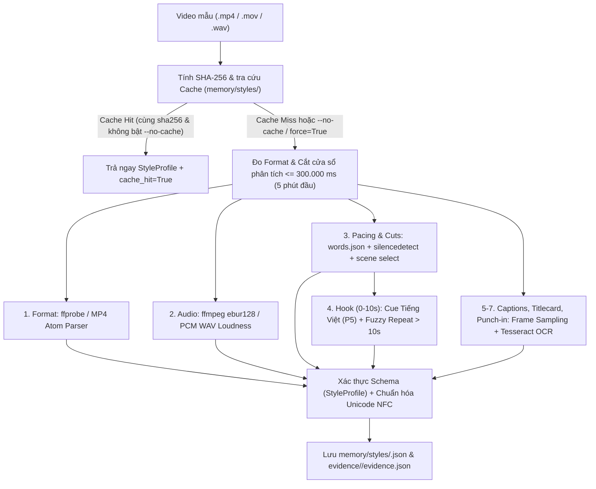

# Luồng Trích Xuất Phong Cách Từ Video Mẫu (`PS1` — `ps1_style_extract.py`)

Tài liệu này mô tả kiến trúc, cơ chế đo đạc, quy tắc giảm cấp an toàn và cấu trúc lưu trữ của Giai đoạn **S1 (`PS1`)** trong hệ thống **PodsCare Video Studio**.

---

## 1. Tổng Quan Kiến Trúc & Ranh Giới Phân Tích

Module [`tools/video-pipeline/phases/ps1_style_extract.py`](file:///Users/macbookpro2020/bed-podscare/tools/video-pipeline/phases/ps1_style_extract.py) (cùng module tương thích ngược [`tools/video-pipeline/phases/ps1_style_analyzer.py`](file:///Users/macbookpro2020/bed-podscare/tools/video-pipeline/phases/ps1_style_analyzer.py)) nhận đầu vào là một file video mẫu (`.mp4`, `.mov`, `.wav`) và xuất ra:
1. **Hồ sơ phong cách chuẩn hóa (`StyleProfile`)**: lưu tại `tools/video-pipeline/memory/styles/<style_id>.json` (và `work/style_profile.json` khi chạy theo workspace).
2. **Bằng chứng trích xuất chi tiết (`evidence.json`)**: lưu tại `tools/video-pipeline/memory/styles/evidence/<style_id>/evidence.json`.
3. **Chỉ mục Cache (`cache_index.json`)**: ánh xạ `sha256 -> style_id` tại `tools/video-pipeline/memory/styles/evidence/cache_index.json`.

---

## 2. Cơ Chế Đo Đạc 7 Nhóm Phong Cách & Mức Độ Tin Cậy (`confidence`)

Mỗi nhóm trong 7 nhóm phong cách (`format`, `pacing`, `hook`, `captions`, `audio`, `titlecard`, `punchin`) đều được gắn nhãn độ tin cậy rõ ràng:
- `measured`: Đo trực tiếp từ công cụ chuẩn (`ffprobe`, `ffmpeg ebur128`, `words.json` + `silencedetect`, `tesseract` OCR).
- `estimated`: Ước lượng xác định từ parser nhị phân MP4, năng lượng sóng âm PCM WAV hoặc tổ hợp tín hiệu.
- `assumed`: Giả định an toàn khi video không có lời nói (`non-speech`) hoặc môi trường thiếu công cụ ngoại vi (`tesseract`, `ffmpeg`), luôn đi kèm cảnh báo trong `warnings`.

| Nhóm | Chỉ số trích xuất chính | Công cụ đo chuẩn (`measured` / `estimated`) | Cơ chế giảm cấp (`assumed` / Fallback) |
| :--- | :--- | :--- | :--- |
| **`format`** | `width`, `height`, `fps`, `aspect`, `template` | `ffprobe` (`measured`) hoặc bộ đọc nhị phân MP4 box `tkhd`/`mvhd`/`mdhd`/`stts` (`estimated`) | Nếu container thiếu header video: suy luận từ kích thước/WAV (`assumed`) |
| **`audio`** | `lufs`, `true_peak_db`, `lra`, `music_detected`, `ducking_db` | `ffmpeg -af ebur128=peak=true` (`measured`) kết hợp phân tích RMS cửa sổ 400ms giữa đoạn nói và đoạn nghỉ | Phân tích trực tiếp 16-bit PCM WAV (`estimated`) hoặc giá trị mặc định an toàn `-16.0 LUFS` (`assumed`) |
| **`pacing`** | `words_per_min`, `pause_median_ms`, `pause_p90_ms`, `max_silence_kept_ms`, `shots_per_min`, `jump_cut_ratio` | `words.json` (P2) + `ffmpeg silencedetect` + `select='gt(scene,0.28)'` (`measured` / `estimated`) | Video không lời nói (`non-speech`): không crash, đặt `confidence.pacing = "assumed"` và ghi cảnh báo rõ |
| **`hook`** | `duration_ms`, `style` (`question`\|`teaser`\|`statement`), `text_overlay`, `repeated_later`, `time_to_first_word_ms` | Đối chiếu từ khóa mở đầu Tiếng Việt (`p5_hook_agent.py`) trong `0–10s` + so khớp chuỗi `difflib` sau mốc `10s` (`estimated`) | Video không lời nói (`non-speech`): đặt `confidence.hook = "assumed"`, `repeated_later = False` |
| **`captions`** | `present`, `position`, `words_per_line`, `lines`, `highlight`, `font_class`, `text_color`, `highlight_color` | Lấy mẫu tối đa 30 khung hình (mỗi 2s trong 60s đầu) + `tesseract` OCR (`vie+eng` TSV) (`measured`) | Thiếu `tesseract` hoặc `ffmpeg`: đặt `confidence.captions = "assumed"`, `ocr_available = False` kèm cảnh báo |
| **`titlecard`** | `present`, `duration_ms`, `position` | Kiểm tra mật độ chữ OCR và bố cục trong `0–3000 ms` đầu (`estimated`) | Không có OCR: gán `confidence.titlecard = "assumed"`, `present = False` |
| **`punchin`** | `detected`, `scale`, `min_gap_s`, `scale_pct`, `frequency_per_min` | Phân tích biến thiên tỷ lệ khung hình ở các cặp cảnh cắt liền kề cùng bối cảnh (`measured` / `estimated`) | Không đủ bằng chứng khung hình: `detected = False`, `confidence.punchin = "assumed"` |

---

## 3. Ràng Buộc Vận Hành & Bộ Nhớ Đệm (`Cache`)

1. **Giới hạn cửa sổ phân tích 5 phút đầu (`MAX_ANALYZE_MS = 300_000`)**:
   - Nếu video mẫu có `duration_ms > 300_000`, bộ trích xuất chỉ phân tích `300_000 ms` đầu tiên (`source.analyzed_ms = 300000`) và tự động ghi cảnh báo vào `warnings` để tránh nghẽn CPU/RAM.
2. **Bộ nhớ đệm theo `SHA-256`**:
   - Trước khi chạy trích xuất nặng, `extract_style_profile()` băm `sha256` toàn bộ file mẫu và tra cứu trong `tools/video-pipeline/memory/styles/`.
   - Nếu tìm thấy hồ sơ hợp lệ cùng `sha256`, hàm trả ngay hồ sơ từ bộ nhớ đệm (`evidence._meta.cache_hit = True`).
   - Có thể ép phân tích lại bằng cờ CLI `--no-cache` / `--force` hoặc tham số Python `no_cache=True` / `force=True`.
3. **Chuẩn hóa Tiếng Việt Unicode NFC**:
   - Toàn bộ chuỗi tên hồ sơ (`name`), câu mở đầu (`first_sentence`), lý do và danh sách `warnings` đều được chuẩn hóa `unicodedata.normalize("NFC", ...)` trước khi lưu đĩa.

---

## 4. Giới Hạn Đã Biết (Known Limitations)

- **Phụ thuộc `tesseract` cho OCR phụ đề đốt sẵn (Burned-in Captions)**: Trên máy chưa cài binary `tesseract`, nhóm `captions` và `titlecard` không thể đọc tọa độ chữ từ khung hình video nên sẽ tự động chuyển về `confidence = "assumed"` (`ocr_available = False`) và cảnh báo rõ cho người dùng.
- **Độ chính xác nhận diện kiểu chữ (`font_class`) và hiệu ứng tô màu từ khóa (`highlight`)**: Khi chỉ dùng OCR văn bản thuần hoặc thống kê điểm ảnh cơ bản, việc phân loại phông chữ chỉ dừng ở nhóm đại diện (`sans_bold`, `sans_regular`, `rounded_bold`, `serif_bold`) để tầng `PS2` ánh xạ sang danh sách phông chữ hỗ trợ dấu Tiếng Việt.
- **Video chỉ có nhạc nền / B-roll không lời nói (`non-speech`)**: Các chỉ số tốc độ nói (`words_per_min`) và cấu trúc mở đầu (`hook`) không có ngữ liệu lời nói thực tế nên được đánh dấu `assumed` để tầng `PS2` ưu tiên giữ ngưỡng mặc định an toàn.
